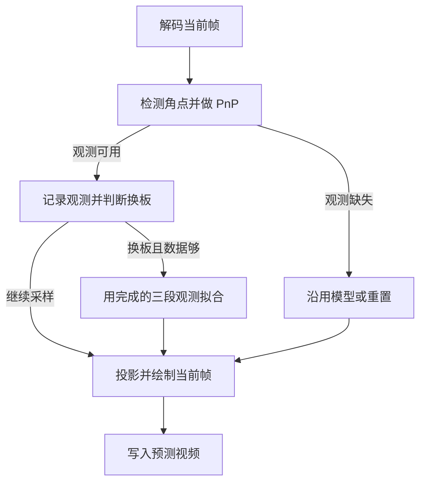

# 旋转模型建模项目说明（Writen BY GPT）

## 1. 运行方法

在包含 `main.py` 的项目目录运行以下命令。现有的 `yolo` 环境包含 Python、NumPy 和 OpenCV。

```powershell
conda activate yolo
python main.py
```

程序读取 `input/video.avi`，生成 `output/prediction.mp4`。预测视频与输入一帧对应一帧，帧号从 0 开始。时间用 `frame_id / fps` 计算。这里的时间是视频进度，程序运行快慢对它没有影响。

也可以指定视频路径和输出路径。输出使用 `.mp4`，输入应来自同一套相机标定和三板几何尺寸。

```powershell
python main.py --input input/video.avi --output output/prediction_review.mp4
```

独立的距离滤波测试通过 `python filter.py` 运行，生成 `output/filter_test.csv` 并在终端打印误差和响应延迟。

### 视频标注

| 画面里的元素                           | 含义                                               |
| -------------------------------- | ------------------------------------------------ |
| 绿色菱形 `C`                         | 拟合旋转中心的图像投影                                      |
| 绿色箭头 `Axis +a`                   | 公共旋转轴的一段，箭头指向轴的正方向                               |
| 青色 `minus`、黄色 `middle`、粉色 `plus` | 三个轴向层级的预测板中心。颜色与板号固定对应                           |
| 从轴线伸出的同色线段                       | 该板所在层的圆心到预测板中心的半径线。轴上空心圆标出这一层的圆心，中间层圆心与 `C` 重合   |
| 白色四边形与十字                         | 当前帧通过 PnP 检查的实测四角和四角像素坐标的平均值                     |
| 白色细线                             | 实测中心与关联到的预测中心之间的像素连线                             |
| `Fit at frame`、`theta`、`omega`   | 当前模型的拟合帧号、中间板相位和角速度，角度用 rad，角速度用 rad/s           |
| `center gap`                     | 白色十字和同板预测中心的像素距离，以及它们对应的三维中心距离。两个数字分别以 px 和 m 表示 |

`Collecting observations` 表示正在积累有效观测。`Waiting for PnP` 表示这一帧没有可用观测，当前也没有模型。`PnP unavailable \| model prediction` 表示使用上一次成功拟合的模型计算这一帧的位置。三块板都按模型位置投影，因此它们在原画面上被挡住时，预测点仍可能显示。

## 2. 原理和坐标

### 相机坐标与装甲板坐标

每块板的局部坐标以板中心为原点。四个角点依次为左上、右上、右下、左下。`solve_pnp()` 解出 `rvec`、`tvec`，用它们能把装甲板局部坐标映射到相机坐标。因为局部板中心的坐标是零，板中心在相机坐标系下就是 `tvec`。


相机原点为光心，$X$ 向右，$Y$ 向下，$Z$ 向相机前方。三维坐标用米。像素坐标 $(u,v)$ 以图像左上角为原点，向右和向下增加。

| `Const.py` 中的常量 | 含义 |
| --- | --- |
| `image_width = 1280`、`image_height = 1024` | 与相机标定配套的图像尺寸，单位 px |
| `w = 0.135`、`h = 0.056` | 单块装甲板宽和高，单位 m |
| `objectPoints` | 形状 $(4,3)$ 的四个局部角点，横纵坐标分别取 $\pm w/2$、$\pm h/2$，第三个坐标全为零 |
| `R = 0.275`、`interval = 0.102` | 旋转半径和相邻两层的轴向间隔，单位 m |
| `K` | 相机内参矩阵，包含像素焦距 $f_x,f_y$ 和主点 $(c_x,c_y)$ |
| `D` | 畸变参数，顺序为 `k1, k2, p1, p2, k3` |

### 三块板的位置公式

设 `C` 是拟合的整体旋转中心，`a` 是长度为 1 的公共旋转轴方向。轴线上的任一点都可以写成 $C+s a$。`e0` 和 `e90` 是垂直于轴的平面内两根互相垂直、长度为 1 的向量。零度沿 `e0`，正 90° 沿 `e90`。

令 `mode` 取 $+1$ 或 $-1$，用来表示两种可能的板间相位排列。

| 板号 | 轴向位置 $h_i$ | 相对中间板的相位 $\delta_i$ |
| --- | ---: | ---: |
| `minus` | $-0.102\ \mathrm{m}$ | $\text{mode}\cdot 2\pi/3$ |
| `middle` | $0$ | $0$ |
| `plus` | $+0.102\ \mathrm{m}$ | $-\text{mode}\cdot 2\pi/3$ |

程序中的角度直线是 $\theta(t)=\omega t+\theta_0$。第 $i$ 块板的中心位置为

$$
P_i(t)=C+h_i a+R\bigl[e_0\cos(\theta(t)+\delta_i)+e_{90}\sin(\theta(t)+\delta_i)\bigr].
$$

$C+h_i a$ 决定板在哪一层转动，方括号决定它转到了这一层圆周上的哪个方向。把 $P_i-C$ 沿轴投影，得到半径线在轴上的起点

$$
Q_i=C+\bigl((P_i-C)\cdot a\bigr)a=C+h_i a.
$$

等式成立是因为两个径向基向量都垂直于 `a`，沿 `a` 的点积只剩 $h_i$。因此 $Q_i$ 到 $P_i$ 的三维距离为 `R`。三维半径线经过相机透视投影之后，屏幕上的长度和夹角会随板的位置变化。

## 3. 主流程



1. 扫描当前帧里的红橙色灯条，配对得到装甲板四角，对候选运行 PnP。主流程使用检测列表中下标为 0 的候选作为本帧观测。
2. 将有效 `tvec` 与上一条有效 `tvec` 比较。中心距离小于 `3 * Const.w` 时续写当前观测段，否则认为发生换板。三条列表按换板顺序循环复用，每条保存一段连续看见的板中心和对应时间。
3. 换板时先检查此前的三段数据。每段至少有 20 条观测，且三段观测数之和除以帧率达到 0.5 s，就尝试拟合。新板的第一条观测在这次拟合之后写入下一段。
4. 依次拟合三条固定半径圆弧，估计公共旋转中心与轴向，按轴向高度确定三段的物理板号。用中间段拟合角速度和初相位，再比较两种板间相位排列的误差。
5. 每帧使用当时最近一次成功拟合的参数，在当前视频时间计算三块板的位置。若本帧有观测，取三维中心距离最近的一块板做关联。视频随即写出带标注的当前帧。
6. 短暂丢失观测时仍按模型显示预测。连续缺失时间超过 0.5 s 时清空跟踪数据和模型，等重新积累到足够数据再恢复标注。

## 4. 视频入口与基本输入输出

### `main.py`

#### `main()`

用 `argparse` 读取 `--input` 和 `--output`，默认路径相对于 `main.py` 所在目录。调用 `video_process()` 处理视频，成功后用 `Create_csv_observations()` 初始化 `output/data.csv` 的表头。命令行通过 `if __name__ == "__main__"` 进入这里。

#### `video_process(video_path, output_path)`

1. 将参数变成 `Path`，检查输出扩展名和输入输出路径。然后用 `cv.VideoCapture` 打开视频并解码首帧。
2. 读取视频帧率。元数据里的帧率无效时采用 `REFERENCE_FPS = 119.997728`，同时在终端打印。
3. 调用 `_reset_tracking()` 清空上一轮运行的观测。以标定尺寸创建 MP4 写入器，必要时先把帧缩放到这一尺寸，保证检测坐标、预测投影和输出画布使用同一个像素尺度。
4. 对每张解码得到的帧计算帧号和时间，调用 `frame_process()`。函数返回的图像在同一次循环中写入一次。
5. 结束后释放写入器，再把临时视频移到最终路径。随后释放读取器，打印并返回写出的帧数。用临时文件可以让上次生成的视频在本次处理结束之前继续保留。

#### `frame_process(frame_id, time_s, frame)`

先调用 `PnP.image_process()`。该函数返回元组、平移向量有限且深度为正时，取 `tvec[:, 0]` 得到长度为 3 的中心坐标。失败时累加 `missed_frames`，按丢失时长选择沿用模型或清空状态，然后返回标注图。

成功时先把连续缺失计数清零。只有当上一条有效观测存在且 `Same_aim()` 判为换板，才检查旧三段并尝试用 `_fit_model()` 更新模型。新拟合有效时替换 `model` 和 `fit_frame_id`。随后循环移动 `pointer`，清空准备复用的观测段，再追加本帧位置与时间。积累中的数据分别存在 `data` 和 `data_time`，两个列表里的同下标元素一一对应。

若当前有模型，调用 `Get_plate_id()` 得到关联板号。叠加层采用 `middle` 作为中间板的名称，所以在这里把旧接口的 `mid` 转成 `middle`。最后调用 `draw_prediction()` 返回绘制完的帧。

#### `_reset_tracking()`

重建三条位置列表和三条时间列表，把 `pointer`、`missed_frames` 清零，并清除 `last_center`、`model` 和 `fit_frame_id`。视频开始和连续缺失超过 0.5 s 时调用。

#### `_fit_model(frame_id)`

复制三条位置列表和三个时间列表，交给新的 `fitting.model`，使这次拟合的数据窗口在后续循环复用观测列表时依然完整。调用 `start()` 计算参数。样本退化、拟合未收敛、线性代数异常或相位排列未通过误差比较时，打印原因并返回 `None`。成功时返回新模型并打印角速度。调用方在拟合失败时沿用此前成功的模型。

#### `_open_prediction_writer(path, frame_size)`

创建 `cv.VideoWriter`，编码器为 `mp4v`，帧率为输入视频帧率。确认写入器可用后返回，打开失败时抛出文件相关错误。

### `input.py` 与 `PnP/input.py`

**`Input_image(image_path=None)`** 在直接传路径时调用 `cv.imread` 读取 BGR 图像并返回。参数为空时，从命令行的 `--image_path` 读取路径，默认是 `./input/img.png`。读取失败由 `cv.imread` 返回 `None`。两个文件中的实现相同。

### `output.py`

**`Create_csv_observations(path="./output/data.csv")`** 用 UTF-8 BOM 打开 CSV，以 `headers` 为首行写入字段名。当前视频入口只调用这一初始化函数，所以这个文件只有表头。表头预留了帧号、四角、PnP 位姿、关联板号、距离和状态字段。

## 5. 单帧检测与 PnP

### `PnP/Find_Aim.py`

| 函数 | 作用与实现流程 |
| --- | --- |
| `Creat_mask_by_inRange(hsv, color)` | 依据 HSV 范围取掩码。橙色范围是 `[10,76,204]` 到 `[40,255,255]`，蓝色是 `[100,100,178]` 到 `[130,255,255]`，红色分高色相 `[160,150,150]` 到 `[180,255,255]` 和低色相 `[0,150,108]` 到 `[10,255,255]` 两段。红色两段按像素取并集。 |
| `Blur_img(img, way, kernel_size)` | 按 `way` 调用高斯、中值、双边或均值滤波。默认是 3×3 高斯模糊，`"None"` 路径会直接返回原图。 |
| `Close_img(img, kernel_size)` | 用全 1 方形核做闭运算，先膨胀再腐蚀，填灯条里的小孔和很窄的断口。 |
| `Open_img(img, kernel_size)` | 用全 1 方形核做开运算，先腐蚀再膨胀，去掉小亮点。当前掩码流程调用的是 `Close_img()`。 |
| `Get_mask(img)` | 将 BGR 图做高斯模糊，转成 HSV，合并红色与橙色掩码，再用 5×5 核做闭运算。返回二值掩码。 |
| `check_light(rect)` | 把旋转矩形的短边当宽、长边当高。面积至少 20 px² 且长宽比至少为 2 的矩形才作为灯条。 |
| `find_light(mask)` | 用 `RETR_EXTERNAL` 提取最外层轮廓，对每条轮廓求 `minAreaRect`，交给 `check_light()` 筛选。返回灯条旋转矩形列表。 |
| `get_angle(rect)` | 将 OpenCV 的旋转矩形角度统一到长边。第二条边较长时加 90°，最后用模 180° 表示无箭头的直线方向。 |
| `check_match(light1, light2)` | 取两条灯的长边和中心坐标。依次检查长边角度差不超过 20°、长度相对差不超过 30%、中心像素纵差不超过第一条灯长的 0.5 倍，以及横差在第一条灯长的 1 到 5 倍之间。通过则返回 1。 |
| `sort_points(points)` | 按图像纵坐标分出上方两点和下方两点，再在每组按横坐标区分左右。返回顺序为左上、左下、右上、右下。 |
| `Get_aim(light1, light2)` | 调用 `boxPoints()` 取得两条灯的四角并排序，按灯条中心横坐标区分左右灯。取左灯外侧两角与右灯外侧两角，返回左上、右上、右下、左下四点。 |
| `Match_light(lights)` | 枚举所有不同灯条对，调用 `check_match()` 判断是否成对。用 `Get_aim()` 提取通过的四角，加入结果列表。 |
| `Dispose_image_inRange(img)` | 顺序调用 `Get_mask()`、`find_light()` 和 `Match_light()`，输出装甲板候选角点列表。 |

### `PnP/Solve_PnP.py`

- **`solve_pnp(aim_points)`** 把检测到的四个像素点转换为 `float64`，与 `Const.objectPoints` 按同一顺序送入 `cv.solvePnP`，同时传入 `K` 和 `D`。返回求解成功标志、`rvec` 和 `tvec`。
- **`PnP_img(array_aim_points)`** 按候选顺序循环调用 `solve_pnp()`，分别累积三个同顺序列表后返回。每个列表里同一个下标都对应同一候选。

### `PnP/projectPoints.py`

- **`project_points(objectPoints, rvec, tvec)`** 调用 `cv.projectPoints`。先由 `rvec`、`tvec` 把输入点映射到相机坐标，再用内参和畸变转换为像素。返回 OpenCV 的投影数组，形状通常是 $(N,1,2)$。
- **`project_points_img(array_ret, array_rvec, array_tvec)`** 对 PnP 成功的候选，将四个已知三维角点投影到图像，展成 $(4,2)$ 并转换为整数像素。对于失败的候选，在对应位置放 `None`。这些结果与检测角点比较，用于计算重投影误差。

### `PnP/tools.py`

- **`Get_reprojection_error(aim_points, imagePoints)`** 将每个检测角与同顺序的重投影角作差，取二维欧氏距离，再求四个距离的算术平均。投影为空时返回 `None`。
- **`check_PnP(aim_points, imagePoints, tvec_z)`** 用上边两角的横坐标差 `p` 粗估深度 $Z_{\mathrm{rough}}= f_x w/p$，得到它和 PnP 深度的相对差 $|Z_{\mathrm{rough}}-t_z|/\min(t_z,Z_{\mathrm{rough}})$。平均角点重投影误差超过 5 px 时返回 `2`，深度小于 0 时返回 `3`，相对差超过 10 时返回 `4`。其余情况返回 `0`。

### `PnP/image_process.py`

- **`image_process(img)`** 将图像调整到标定尺寸，运行灯条阈值检测。候选为空时返回 `-1`。有候选时对所有候选求解 PnP 并将三维四角重投影到图像，在下标为 0 的候选上计算四角均值和重投影误差。PnP 返回失败时输出 `1`，质量检查拒绝时转交检查代码。通过时返回 `(aim_points, center, tvec, rvec, reprojection_error)`，其中 `center` 是二维像素中心，`tvec` 和 `rvec` 的形状通常为 $(3,1)$。
- **`video_process(video_path)`** 是早期的视频入口。它打开视频和 `./outputs/Output_video.avi`，初始化旧 CSV，逐帧读取视频时间并尝试写结果。循环中保留的三参数 `image_process(frame_id, time_s, frame)` 调用与现有单参数签名不兼容，直接运行会得到 `TypeError`。当前可运行入口是 `main.py` 中的同名函数。

## 6. 固定半径圆拟合与旋转模型

### `fit_circle_fixed_radius.py`

**`fit_circle_fixed_radius(data, R)`** 用已知半径拟合一条空间圆弧，实际返回 `(center, R, normal)`。`center` 和 `normal` 都是长度为 3 的数组。拟合通过减小观测点到圆周的三维距离平方和来估计圆的位置，允许这些点略微偏离圆周所在平面。

1. 将输入变成 $(N,3)$ 数组，兼容单个点为 $(3,1)$ 或 $(1,3)$ 的输入。检查点数至少为 3、位置均有限、半径为正。
2. 将点集重心作为临时坐标原点，并把长度除以 `R`，使目标半径变成 1。对点云作奇异值分解 SVD。这里 SVD 给出点云最展开的方向，前两个方向张成初始圆平面。第二个奇异值太小时，说明点近似排成直线，无法确定圆平面。
3. 投影到初始平面，用最小二乘估一个朝向圆心的二维方向。用单位圆几何估一个圆心离重心的距离，分别在两个相反方向上生成圆和相位初值。短弧向哪边弯容易受噪声影响，所以两边都尝试。
4. 每个初值最多迭代 300 次。固定相位时，从 $(\cos\theta-1,\sin\theta)$ 构造一组二维圆周模板。代码用 $-2\sin^2(\theta/2)$ 计算第一项，能在很小的角度下保持精度。将模板去均值，再用 SVD 求把它放进三维点云时平方误差最小的两根垂直基向量。
5. 固定圆时，把每个观测点投影到圆平面，以圆心为原点用 `atan2` 更新相位。这个方向上的圆周点与观测点最近。角度最大变化小于 $10^{-12}$ rad，或相邻迭代平方误差之差不超过当前误差的 $10^{-13}$ 倍时，停止该方向的迭代。
6. 比较收敛结果的平方误差，选误差较小的那个。把中心还原成以米为单位的相机坐标，叉乘两根基向量得到单位法向。最后让法向绝对值最大的分量取正，统一同一平面的两个法向符号。两个初值都未收敛时抛出 `RuntimeError`。

### `fitting.py` 中的 `model` 类

#### `__init__(data, data_time)`

保存三组输入的位置和时间，初始化几何参数 `C`、`a`、`e0`、`e90`、时相参数 `omega`、`theta0` 以及用于拟合的样本和圆弧结果。`states` 初始为 1，`mode` 初始为 1。每次尝试拟合会创建一个新实例。

#### `start()`

1. 用 `fit_circle_fixed_radius()` 对三段观测分别拟合圆，保存三组中心、半径和法向，然后调用 `check()`。
2. 三个圆心取平均作为 `C`。理想情况下三层沿同一轴对称分布，三个偏移 $-0.102a$、$0$、$+0.102a$ 相加为零，因此平均值位于中间层。
3. 用 `fit_parallel_direction()` 从三个圆平面法向量求公共单位轴向 `a`。按 $a_y,a_x,a_z$ 的顺序检查绝对值大于 $10^{-6}$ 的第一个分量，把它定为负值，从而固定轴的正方向。
4. 计算三个圆心在轴上的高度，即 `(array_center - C) @ a`，从小到大得到 `minus_id`、`mid_id`、`plus_id`。这三个下标指向观测列表，可随轮换变化。物理板号由沿轴的相对高度定义。
5. 调用 `update_e0_e90()` 建立旋转所在平面的角度基，再从中间层观测提取相位。调用 `fit_line()` 拟合时间与相位，得到 `omega` 和 `theta0`。
6. 调用 `chose_model()` 评估两种相位排列。若两种排列的误差过于接近，把 `states` 设为 0。视频入口只采用通过筛选的实例。

##### 中间板相位的计算

中间层每个观测点 $p=(x,y,z)$ 沿相机射线移动到固定的深度 $z_f=C_z-R$，得到

$$
q=p\,\frac{z_f}{z}
 = z_f\left(\frac{x}{z},\frac{y}{z},1\right).
$$

如果同一个像素方向里的 PnP 观测整体被乘上比例 $\lambda$，那么 $x/z$ 和 $y/z$ 不变，因此这类沿射线的尺度误差在这一步抵消。随后计算 $u=(q-C)\cdot e_0/R$，将 $u$ 限制在 $[-1,1]$，然后用 $\arccos(u)$ 得到角度大小。`front_sign` 依据 `e90[2]` 选符号。`e90[2] < 0` 时，沿正的 `e90` 方向会让深度减小，采用正角度分支。

固定深度与单侧角度分支都属于近似。真实板中心的深度随相位改变，像素检测误差还会改变射线方向。模型对这些偏差的敏感程度可以用视频中的 `center gap` 检查。

#### `fit_parallel_direction(vectors)`

验证输入是形状 $(N,3)$ 的有限非零向量。先逐行按最大绝对值缩放，再把每行变成单位向量，组成矩阵 $V$。取 $V^\mathsf{T}V$ 最大特征值对应的单位特征向量。这个方向使各输入向量在它上面的投影长度平方之和最大，也就是与这些法向量最接近平行的公共方向。然后按点积的正负数目选朝向，多数同向的一边优先，平局以第一个输入向量为准。`start()` 随后按坐标分量约定统一符号。

#### `update_e0_e90()`

先确认 `a` 非零，再从相机正 $X$ 向量减去它沿轴的分量，留下垂直于轴的部分。若该部分长度小于 $10^{-6}$，用正 $Z$ 方向重算。把结果单位化得到 `e0`，再通过 `np.cross(a, e0)` 得到 `e90`。

#### `fit_line(array_x, array_y)`

检查时间和角度是一一对应的有限一维数组，至少有两项，时间也要有变化。按时间稳定排序，同时调整角度顺序。用 `np.unwrap` 处理相邻角度跨越 $\pm\pi$ 时出现的一个整周的跳变。将时间减去首个时间，用 `np.polyfit(..., deg=1)` 求最小二乘直线，再换回原时间坐标，返回斜率 `omega` 和截距 `theta0`。

#### `Get_theta_mid(t)` 与 `Predict_position(i, t)`

- **`Get_theta_mid(t)`** 计算 `omega * t + theta0`，调用 `normalize_angle()` 把结果表示在 $[-\pi,\pi)$。画面中的角度经过这个取值区间，所以跨越边界时可能从接近 $\pi$ 跳到接近 $-\pi$，而同样的三角函数位置可以连续变化。
- **`Predict_position(i, t)`** 根据 `minus`、`middle` 或 `plus` 取出 $h_i,\delta_i$。先把 `C` 沿 `a` 移到这一层，再根据当前角度和相对相位沿 `e0`、`e90` 加两个长度分量，返回相机坐标系下的三维板中心。

#### `chose_model()`

将 `mode` 先设为 $+1$，再设为 $-1$。每次遍历负向层和正向层的观测样本，用它们各自的时间和板号调用 `Predict_position()`，求观测－预测的三维距离平方。将平方和除以样本数再开根号得到 RMSE，单位为米。两次比较使用同一批样本。只有较小值严格小于较大值且不超过其 90% 时才选对应排列。中间层自身的偏移固定为零，所以这一误差比较只使用两侧。

#### `Get_plate_id(time_s, coordinate, rvec, tvec)`

在模型有效时得到三块板的预测中心，分别计算与当前 `coordinate` 的三维距离平方，返回最近的板号。等距离时分支优先顺序为 `mid`、`plus`、`minus`。`rvec`、`tvec` 保留在旧接口参数中，当前距离计算只用 `coordinate`。模型无效时返回旧接口中的 `"unknow"`。

#### 备用方法

| 函数 | 实现流程 |
| --- | --- |
| `fit_circle_3d(data)` | 估计未知半径的空间圆。对点去均值并按最大绝对量缩放，通过 SVD 得到二维平面和法向量。在二维平面上对 $2Ax+2By+c=x^2+y^2$ 做最小二乘，恢复三维圆心与半径。退化到共线时抛出异常。返回圆心、半径、单位法向，当前 `start()` 选择的是固定半径版本。 |
| `find_middle_point(a, b, c)` | 将每个点与其余两点的中点比较，返回差值范数最小者的下标。当前 `start()` 用轴向投影排序确定层级。 |
| `check_R()` | 检查 `aims` 中三条拟合半径是否都落在 $(R-0.5,\ R+0.5)$，越界就把 `states` 设为 0。当前主流程的半径由常量给定。 |
| `check()` | `start()` 中预留的有效性检查入口，函数体为 `pass`。 |

### 根目录 `tools.py`

| 函数 | 作用与实现流程 |
| --- | --- |
| `Same_aim(point_a, point_b)` | 对三维中心之差取欧氏范数。距离小于 `3 * Const.w = 0.405 m` 时返回 1，否则为 0。 |
| `Get_reprojection_error(aim_points, imagePoints)` | 逐角计算同名点的二维距离，再取平均。投影为空时返回 `None`。视频里的 PnP 模块使用 `PnP/tools.py` 中的同类函数。 |
| `check_fitting(data, fps)` | 用三个列表长度除以帧率估计观测时长，每组至少 20 条且估计时长至少 0.5 s 时返回 1。计时口径是样本数换算出的时间。 |
| `normalize_angle(angle)` | 先加 $\pi$，再模 $2\pi$，最后减 $\pi$，把角度放回 $[-\pi,\pi)$。 |
| `projectPoints(coordinate, rvec, tvec)` | 把单个三维点转换为 OpenCV 接受的 $(1,1,3)$ 数组，按给定外参、`K` 和 `D` 投影，返回长度为 2 的像素坐标数组。 |

## 7. 预测视频叠加绘制

### `prediction_overlay.py`

- **`_project_camera_points(points)`** 将一组三维点转换为 `float64`，找出有限且 $Z>0$ 的点。它们已经是相机坐标，所以通过 `PnP.projectPoints.project_points()` 用零旋转、零平移和同一套 `K`、`D` 一起投影。每个可绘制的结果保留浮点像素，非法深度或无效投影在原下标的位置返回 `None`。
- **`_round_pixel(pixel)`** 用 Python 的 `round()` 把浮点像素点转换为 OpenCV 绘图用的整型二元组，空点保持 `None`。
- **`_draw_label(frame, text, anchor, color, to_left)`** 只给落在画布内的点加标签。先测量文字宽、高，按标志选择放左边或右边，靠近边界时调整文字位置。先画深色粗描边，再画彩色正文，使文字在明暗背景上都可读。
- **`_draw_hud(frame, lines)`** 根据最长一行计算信息面板宽度。对左上角矩形区域混入深色，再逐行写入帧号、时间、模型和误差字符串。
- **`draw_prediction(frame, frame_id, time_s, model, fit_frame_id, observation, plate_id)`** 有观测时先画四角轮廓。模型有效时调用三次 `Predict_position()`，再用点积计算对应的三个轴上落点。把 `C`、轴线的两个端点、三个落点和三个板中心批量投影，画出轴箭头、半径、点和板号。板号优先放在背离半径线的一侧。
- **`draw_prediction()` 的误差与返回值** 有关联观测时，以浮点像素计算预测中心与检测四角均值的距离，以三维坐标计算预测中心与 `tvec` 的欧氏距离。随后画中心连线、实测中心十字及信息面板。返回在原帧上画好的图像。这里的 `center gap` 衡量模型中心与观测的一致程度。PnP 的 `reprojection_error` 则衡量同一块板的四角解算与检测像素之间的平均差。

## 8. 独立距离滤波

### `filter.py` 中的 `RobustDistanceFilter`

- **`__init__(alpha, jump_threshold, confirm_samples, confirm_tolerance, max_gap_s)`** 保存滤波参数并调用 `reset()`。默认新观测权重为 0.1，跳变阈值为 0.12 m，确认样本数为 3，确认容许差为 0.08 m，重置时间间隔为 0.5 s。
- **`reset()`** 清空当前滤波值、上次有效时间、待确认的跳变值和累计次数，使下一条有效观测可以直接初始化。
- **`_clear_pending()`** 把待确认值清空并将计数归零。用于成功初始化、正常小变化及跳变已确认后的状态清理。
- **`update(time_s, observed_m)`** 收到 `None`、无穷、NaN 或非正距离时返回 `None`。首个有效值或超过最大间隔的新值直接作为当前输出。测量与滤波值差不超过阈值时，按 $y_{\text{new}}=(1-\alpha)y_{\text{old}}+\alpha z$ 更新。超过阈值时先记录待确认值，后续相近的异常值更新候选的运行平均和计数，差得太远则开始新的候选。累计足够多的样本后，用当前测量值接受跳变。每次成功处理有效输入后更新 `last_time` 并返回滤波值。

### `run_filter_test(output_csv="filter_test.csv", alpha=0.10)`

1. 创建一个独立滤波器，以 100 Hz 生成 601 个样本。参考值在第 200 个下标从 2.50 m 跳到 3.00 m，观测叠加两个周期扰动 $0.02\sin(6\pi t)+0.01\sin(34\pi t)$，第 150 个下标额外加 0.40 m。
2. 依序用时间和观测调用 `update()`，将下标、时间、参考值、原始观测和滤波结果写入 CSV。
3. 使用内部函数 `mae(lo, hi, column)` 计算两个稳定区间的平均绝对误差。这个函数逐项取指定列与参考值的差的绝对值，求和后除以区间样本数。
4. 单独计算第 150 个样本上的原始和滤波误差。从第 200 个样本开始搜索连续三个输出都距 3.00 m 不超过 0.05 m 的第一个下标，换算阶跃延迟。打印并返回全部指标字典。

当前距离滤波通过这个独立测试入口运行。主视频调用链把 `tvec` 用于分段和旋转几何拟合。

| 默认参数的测试指标 | 原始观测 | 滤波输出 |
| --- | ---: | ---: |
| 第 0 至 99 个样本的 MAE | 0.01350 m | 0.00645 m |
| 第 300 至 399 个样本的 MAE | 0.01350 m | 0.00624 m |
| 第 150 个样本的绝对误差 | 0.40000 m | 0.00988 m |

默认参数下的阶跃响应延迟为 0.02 s。

## 9. 旧版单帧输出和实验脚本

### `PnP/output.py`

| 函数 | 作用与实现流程 |
| --- | --- |
| `Out_image(img, filename)` | 创建 `outputs` 目录，用 `cv.imwrite` 将当前图保存为 `outputs/<filename>.png`。 |
| `Create_csv()` | 创建旧版 `outputs/data.csv`，写入帧号、候选、检测和 PnP 标志、平移旋转分量、斜距及像素误差字段。 |
| `Find_None_Aim(frame_id, time_s)` | 以追加模式写一条无候选记录，包含帧号、时间和布尔值 `False`。 |
| `Get_reprojection_error(aim_points, imagePoints)` | 计算每对检测与投影点之间的像素距离，再求平均。投影为空时返回 `None`。 |
| `check_PnP(ret, aim_points, imagePoints, tvec)` | 从两角横差计算粗估深度，与 PnP 深度求相对偏差。要求求解成功、平均重投影误差不超过 5 px、深度非负和相对偏差小于 10，返回 1 或 0。此处 `tvec` 参数实际接收的是标量深度。 |
| `output_frame_csv(frame_id, time_s, array_detect, array_ret, array_rvec, array_tvec, array_aim_points, array_imagePoints)` | 遍历候选，追加每个候选的帧号、时间、下标和检测标志。通过 `check_PnP()` 的行追加三维平移、平移模长、旋转分量和重投影误差，失败的行只追加 PnP 失败标志。`array_detect` 是旧接口保留参数。 |

### `PnP/test/Single-factor sensitivity.py`

- **`Get_reprojection_error(aim_points, imagePoints)`** 逐角比较两组像素点，返回平均二维距离。投影为空时返回 `None`。
- **`image_process(frame_id, time_s, img)`** 调整图像尺寸、提取候选、做 PnP 和投影，取首个候选的 `tz`、平移向量模长、重投影误差打印。注释中保留了改变焦距、板宽或角点的敏感性实验代码。
- 这个脚本和下面的 `Z_rough_test.py` 都保留了向 `project_points_img()` 额外传入 `result` 的旧调用。当前投影函数只接受三个参数，运行到该处会出现签名不兼容。视频预测入口独立调用现有的三参数接口。

### `PnP/test/Z_rough_test.py`

**`image_process(frame_id, time_s, img)`** 调整尺寸、提取候选并做 PnP。使用首个候选的上边像素宽度计算 $f_xw/p$，打印粗估深度、PnP 深度和百分比差。随后按旧接口尝试投影、写候选 CSV 并返回图像。无候选时写入旧版无观测记录。

## 10. 本次视频验证

用项目的完整 `input/video.avi` 运行得到以下结果。帧号从 0 开始。

| 项目 | 结果 |
| --- | ---: |
| 读入和写出后成功解码的帧数 | 4210 |
| 画面与时长 | 1280 × 1024，约 35.08 s |
| 首次出现预测模型 | 第 317 帧，2.642 s |
| 带模型的帧数 | 3893，占 92.47% |
| 成功拟合次数 | 40 |
| 同时有模型与关联 PnP 观测的帧数 | 3031 |
| 这些帧的中心偏差中位数 | 21.4 px，0.140 m |

第 317 帧拟合得到 `C ≈ (0.213, 0.401, 2.898) m`、`a ≈ (−0.0147, −0.9938, 0.1101)`、`omega ≈ −2.427 rad/s`。此时三段位置样本分别有 76、74、78 条。两侧共 150 个样本参与相位排列的比较。`mode = +1` 的 RMSE 为 0.208 m，`mode = −1` 为 0.459 m，因此选用 `+1`。

| 帧号 | 视频时间 | 当前关联板号 | 像素中心偏差 | 三维中心偏差 |
| ---: | ---: | --- | ---: | ---: |
| 317 | 2.642 s | `middle` | 139.7 px | 0.257 m |
| 345 | 2.875 s | `plus` | 21.6 px | 0.076 m |
| 413 | 3.442 s | `minus` | 157.0 px | 0.311 m |

第 345 帧可清楚看到预测板中心和实测框，第 317、413 帧在换板附近出现了较大偏差。这里统计的参照是当前 PnP 观测，包括 PnP 自身的测量偏差。`input/video_first_2_seconds.avi` 只有 240 帧，适合看检测和初始化画面。要查看拟合后的轴线和三板轨迹标注，使用完整视频。
